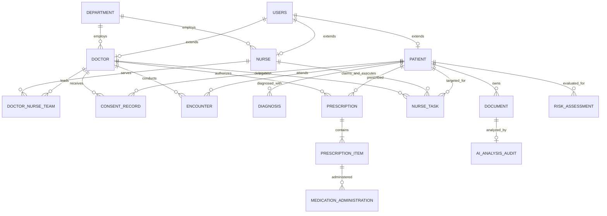

# ConsentCare EHR — Final Database Schema & Architecture

> **Classification**: Persistence Tier Specification  
> **Database Engine**: PostgreSQL 16 Alpine  
> **Migration Management**: Flyway Community Edition (Versions V1 through V17)  
> **Baseline Version**: v1.0-research-demo

---

## 1. Persistence Overview & Migration Timeline

The database schema is strictly versioned through Flyway migration scripts located in `core-service/src/main/resources/db/migration/`. In production, migrations execute automatically during Spring Boot application startup before connection pools are exposed to incoming traffic.

| Version | Migration Script | Scope & Domain |
|---|---|---|
| **V1** | `V1__initial_schema.sql` | Users, roles, doctors, nurses, patients, departments |
| **V2** | `V2__audit_and_envers.sql` | Hibernate Envers audit baseline (`revinfo`, `*_aud`) |
| **V3** | `V3__patient_doctor_relationship.sql` | Doctor-patient care relationships and team assignments |
| **V4** | `V4__consent.sql` | Consent records, categories, expiration, and status |
| **V5** | `V5__documents.sql` | Document metadata, chunks, hashes, and mime-types |
| **V6** | `V6__clinical_records.sql` | Encounters, diagnoses, lab requests, lab reports, observations |
| **V7** | `V7__prescriptions.sql` | Prescriptions, items, and medication administration records |
| **V8** | `V8__nurse_workflow.sql` | Nurse tasks, priority queues, and vital signs records |
| **V9** | `V9__notifications.sql` | Real-time system notifications and read flags |
| **V10** | `V10__ai.sql` | Document AI extraction results and prompt audit logs |
| **V11** | `V11__audit.sql` | Operational system audit log table (`audit_log`) |
| **V12** | `V12__fhir.sql` | FHIR R4 schema mapping alignment fields |
| **V13** | `V13__ehr_architecture_and_pagination.sql` | Pagination indexes and cursor optimization |
| **V14** | `V14__nurse_workflow_and_access_requests.sql` | Access requests workflow and optimistic locking versions |
| **V15** | `V15__ai_real_ml_and_document_understanding.sql` | UCI Random forest risk schema and ground truth fields |
| **V16** | `V16__allow_null_risk_score_and_insufficient_data.sql`| Zero-fabrication schema (nullable scores for insufficient data) |
| **V17** | `V17__security_and_performance_hardening.sql` | Composite B-tree indexes and constraint hardening |

---

## 2. Core Entity-Relationship Diagram



---

## 3. Database Table Catalog

### 3.1 Identity & Organization Domain
* **`users`**: Base credentials table (`id`, `username`, `password_hash`, `email`, `full_name`, `role`, `status`, `created_at`, `version`).
* **`department`**: Clinical divisions (`id`, `name`, `code`, `description`).
* **`doctor`**: Physician profile (`id`, `user_id`, `department_id`, `license_number`, `specialty`).
* **`nurse`**: Nurse profile (`id`, `user_id`, `department_id`, `license_number`, `availability_status`).
* **`patient`**: Patient demographic chart (`id`, `user_id`, `dob`, `gender`, `blood_type`, `phone`, `emergency_contact`, `address`).
* **`doctor_nurse_team`**: Care-team mappings (`id`, `doctor_id`, `nurse_id`, `assigned_at`).

### 3.2 Consent & Access Governance Domain
* **`consent_record`**: Sovereign consent grants (`id`, `patient_id`, `doctor_id`, `category`, `status`, `granted_at`, `expires_at`, `revoked_at`).
  * `category` ENUM: `MEDICAL_HISTORY`, `DIAGNOSES`, `LAB_REPORTS`, `PRESCRIPTIONS`, `DOCUMENTS`, `RISK_ASSESSMENTS`, `CLINICAL_NOTES`.
  * `status` ENUM: `ACTIVE`, `REVOKED`, `EXPIRED`.
* **`access_request`**: Inbound physician access requests (`id`, `patient_id`, `doctor_id`, `category`, `reason`, `status`, `requested_at`, `responded_at`).
* **`document_share`**: Fine-grained individual document sharing (`id`, `document_id`, `doctor_id`, `shared_at`).

### 3.3 Clinical Care Domain
* **`encounter`**: Longitudinal clinical visits (`id`, `patient_id`, `doctor_id`, `encounter_date`, `type`, `summary`, `status`).
* **`diagnosis`**: Problem list entries (`id`, `patient_id`, `doctor_id`, `code`, `description`, `status`, `diagnosed_at`).
* **`prescription`**: Medication orders (`id`, `patient_id`, `doctor_id`, `status`, `prescribed_at`, `notes`).
* **`prescription_item`**: Specific line-item drugs (`id`, `prescription_id`, `medication_name`, `dosage`, `frequency`, `route`, `duration_days`).
* **`medication_administration`**: Bedside administration log (`id`, `prescription_item_id`, `nurse_id`, `administered_at`, `status`, `notes`).
* **`lab_request`**: Diagnostic test orders (`id`, `patient_id`, `doctor_id`, `test_name`, `status`, `ordered_at`).
* **`lab_report`**: Diagnostic test results (`id`, `lab_request_id`, `patient_id`, `doctor_id`, `results_json`, `reported_at`).
* **`observation`**: Vital signs and general clinical findings (`id`, `patient_id`, `encounter_id`, `observation_type`, `value`, `unit`, `observed_at`).

### 3.4 Nurse Care-Team Domain
* **`nurse_task`**: Bedside task queue (`id`, `patient_id`, `doctor_id`, `nurse_id`, `task_type`, `description`, `priority`, `status`, `version`, `created_at`, `completed_at`).
  * Concurrency control: Optimistic locking via `version INT NOT NULL DEFAULT 0`.
* **`vital_signs`**: Structured nursing vitals (`id`, `patient_id`, `nurse_id`, `systolic_bp`, `diastolic_bp`, `heart_rate`, `temperature`, `respiratory_rate`, `oxygen_saturation`, `recorded_at`).

### 3.5 Grounded AI & Risk Domain
* **`document`**: Ingested medical documents (`id`, `patient_id`, `uploaded_by_user_id`, `filename`, `file_type`, `file_size`, `sha256_hash`, `storage_path`, `status`, `created_at`).
* **`ai_analysis_audit`**: Grounded extraction records (`id`, `document_id`, `ai_provider`, `model_name`, `extracted_summary`, `symptoms`, `medications`, `diagnoses`, `raw_response`, `created_at`).
* **`risk_assessment`**: Supervised ML predictions (`id`, `patient_id`, `doctor_id`, `readmission_risk_score`, `risk_level`, `model_name`, `model_version`, `feature_importance_json`, `status`, `created_at`).
  * `readmission_risk_score` is nullable to support `INSUFFICIENT_DATA` outcomes without synthetic fabrication.

### 3.6 Audit & Compliance Domain
* **`audit_log`**: Operational system audit trail (`id`, `timestamp`, `principal_username`, `action`, `resource_type`, `resource_id`, `ip_address`, `status`, `details`).
* **`revinfo`**: Hibernate Envers revision catalog (`rev`, `revtstmp`).
* **`*_aud`**: Envers entity audit ledgers (`users_aud`, `consent_record_aud`, `document_aud`).

---

## 4. Performance Indexes (Flyway V17 Hardened)

To guarantee sub-millisecond query resolution during real-time consent evaluations, task claiming, and timeline rendering, the following composite B-tree indexes are maintained:

```sql
-- Fast ABAC Consent Evaluation
CREATE INDEX idx_consent_patient_doctor_status 
    ON consent_record(patient_id, doctor_id, status);

-- Real-Time Nurse Task Queue by Priority & State
CREATE INDEX idx_nurse_task_nurse_status 
    ON nurse_task(nurse_id, status);
CREATE INDEX idx_nurse_task_patient_status 
    ON nurse_task(patient_id, status);

-- Longitudinal Clinical Timeline & Encounter Search
CREATE INDEX idx_encounter_patient_date 
    ON encounter(patient_id, encounter_date DESC);
CREATE INDEX idx_diagnosis_patient_status 
    ON diagnosis(patient_id, status);

-- Medication History & Administration Lookups
CREATE INDEX idx_prescription_patient_status 
    ON prescription(patient_id, status);
CREATE INDEX idx_med_admin_item_date 
    ON medication_administration(prescription_item_id, administered_at DESC);

-- Fast Audit Log Search by Timestamp and Principal
CREATE INDEX idx_audit_log_timestamp_principal 
    ON audit_log(timestamp DESC, principal_username);
```

---

## 5. Concurrency Control & Data Integrity

1. **Optimistic Locking**:
   * Applied to `nurse_task` and `users` entities using Spring Data `@Version`.
   * Concurrent claims by two nurses on the same task immediately cause an `OptimisticLockException`, resulting in a safe HTTP 400 rejection for the second nurse without race conditions.
2. **Referential Integrity**:
   * Foreign keys with `ON DELETE RESTRICT` protect core clinical records (encounters, diagnoses, prescriptions) from accidental cascading deletion.
   * `document` soft-deletion preserves audit integrity: deleting a document marks `status = 'ARCHIVED'` while retaining the audit hash.
3. **Audit Immutability**:
   * Application-level services lack `UPDATE` or `DELETE` methods for `audit_log` and Envers `*_aud` tables.
   * Database-level triggers prevent mutation of existing audit entries.

